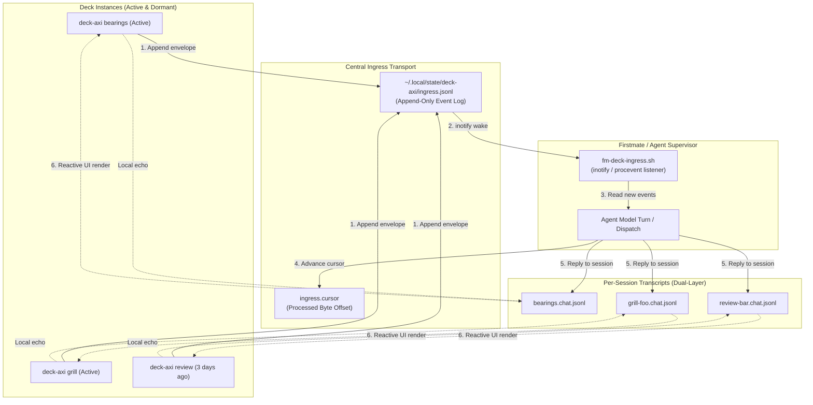

# ADR & Specification: Deck-Axi Central Ingress Bus & Multi-Session Routing

- **Status**: Approved by Captain (2026-10-23)
- **Domain**: `deck-axi` (deliberation cockpit) & `firstmate` (helm supervision & agent routing)
- **Deliberation Artifact**: `.lavish/grill-deck-central-bus-final.html`
- **State Record**: `data/grill/deck-central-bus.json`

---

## 1. Context & Motivation

Previously, `deck-axi` instances either:
1. Ran ephemerally in-memory (when invoked as `deck-axi bearings` without an explicit session file), meaning Deliberation Chat messages stayed in React Ink state and were never written to disk; or
2. Wrote to isolated, per-session chat logs (`<slug>.chat.jsonl`).

Under the per-session model, if the captain operates 4, 5, or 7 decks simultaneously, or types a message into an older deck session from 3 days ago, the agent would have to continuously poll $O(N)$ discrete files across the filesystem, or miss the message entirely.

## 2. Settled Decisions (5 Pillars)



### Pillar 1: Ingress Transport (Unified Append-Only Bus)
- **Path**: `~/.local/state/deck-axi/ingress.jsonl`
- **Protocol**: Single-line JSON envelopes appended by any `deck-axi` instance.
- **Envelope Schema**:
  ```json
  {
    "id": "msg_abc123",
    "deck_id": "deck_789xyz",
    "session_slug": "bearings",
    "session_file": "/home/francjpd/.local/state/deck-axi/bearings.json",
    "chat_file": "/home/francjpd/.local/state/deck-axi/bearings.json.chat.jsonl",
    "mode": "bearings",
    "role": "captain",
    "text": "test it works",
    "ts": 1792770736000
  }
  ```
- **Trade-off Settled**: Replaces complex UDS daemons or WebSocket servers with a zero-daemon, crash-proof file that survives reboots and enables $O(1)$ single-point subscription for Firstmate.

### Pillar 2: Dual-Layer Return Path
- **Central Ingress**: Inbound messages from all decks flow into `ingress.jsonl` for Firstmate.
- **Per-Session Chat**: Each deck maintains its own `<slug>.chat.jsonl` containing its full conversation history.
- **Agent Responses**: Firstmate writes replies directly to the destination deck's `chat_file`.
- **Benefit**: Each deck's scrollback remains clean and isolated without having to filter a noisy global bus.

### Pillar 3: Cold Context Resumption
- Envelopes carry `session_slug`, `session_file`, `mode`, and current round.
- When an event arrives from a deck untouched for 3 days, Firstmate reads the session pointer, loads `session_file`, inspects the current decision tree or telemetry state, and replies with full context without manual re-orientation.

### Pillar 4: Cursor-Tracked Ingress Pruning
- **Cursor Path**: `~/.local/state/deck-axi/ingress.cursor`
- Firstmate records the processed line/byte offset.
- Log rotation triggers when `ingress.jsonl` exceeds 1,000 lines or on session start. Lines prior to the cursor are safely rotated to `ingress.jsonl.old`, leaving active entries untouched.
- **Data Safety Guarantee**: Pruning `ingress.jsonl` **never** touches or deletes any deck's `<slug>.chat.jsonl` transcript.

### Pillar 5: Live Delivery Feedback in TUI
- Deliberation Chat messages render live status badges:
  - `[Sent]`: Successfully flushed to `ingress.jsonl`.
  - `[Seen]`: Acknowledged by Firstmate cursor / watcher.
  - Streaming agent response.

---

## 3. Implementation Roadmap

1. **Unit 1 (`deck-axi` Client & Default Session Binding)**:
   - Ensure standalone invocations (`deck-axi bearings`, `deck-axi`) default to canonical persistent session paths (`~/.local/state/deck-axi/<mode>.json`).
   - Implement `src/bus.ts` in `deck-axi` to dual-write captain messages to both `<chat_file>` and `ingress.jsonl`.
2. **Unit 2 (`firstmate` Ingress Ingestion Watcher)**:
   - Implement `bin/fm-deck-ingress.sh` with cursor tracking (`ingress.cursor`) and `procevent` reactive wake.
   - Wire incoming deck messages into Firstmate's supervision and steering loops.
3. **Unit 3 (TUI Delivery Badges & Verification)**:
   - Add delivery state indicators (`[Sent]` / `[Seen]`) to `deck-axi`'s `ChatStream.tsx`.
   - Comprehensive test coverage in `test/bus.test.ts` and `tests/fm-deck-ingress.test.sh`.
